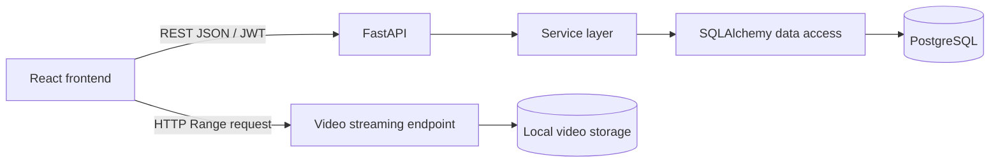

# Application Architecture

## 1. Architectural style

Use a small, modular, three-layer application:
1. React frontend — existing screens, navigation, and user interactions.
2. FastAPI backend — REST API, authentication, validation, business rules, and local video streaming.
3. PostgreSQL — persistent application data.

The frontend communicates with the backend over HTTP/JSON. Video bytes are delivered by a dedicated streaming endpoint.

## 2. Technology decisions

| Area | Choice |
|---|---|
| Frontend | Existing React 19 + Vite 7 + JavaScript |
| Routing | Existing React Router 7 |
| Backend | Python + FastAPI |
| API contract | REST + JSON, versioned at `/api/v1` |
| Validation | Pydantic |
| ORM | SQLAlchemy 2.x |
| Database | PostgreSQL |
| Migrations | Alembic |
| Authentication | JWT bearer access tokens |
| Password hashing | Argon2id |
| Video storage | Local filesystem |
| Testing | pytest for backend; existing frontend lint/build plus focused component/API tests |

SQLAlchemy, Alembic, Argon2id, and the testing libraries are implementation recommendations to use when setting up the backend; they are not currently installed in the frontend repository.

## 3. High-level request flow



- The browser calls API endpoints for video lists, search, categories, comments, reactions, and authentication.
- FastAPI routes validate input and delegate work to service functions.
- Services apply business rules and use SQLAlchemy to access PostgreSQL.
- The streaming route resolves a validated storage key and streams the local file. It must not expose arbitrary filesystem paths.

## 4. Suggested backend structure

```text
backend/
  app/
    main.py
    core/
      config.py
      security.py
      database.py
    api/
      deps.py
      v1/
        router.py
        endpoints/
          auth.py
          videos.py
          categories.py
          comments.py
          reactions.py
    models/
      user.py
      video.py
      category.py
      comment.py
      reaction.py
      video_view.py
    schemas/
      auth.py
      user.py
      video.py
      category.py
      comment.py
      reaction.py
    services/
      auth_service.py
      video_service.py
      comment_service.py
      reaction_service.py
      storage_service.py
    repositories/
    tests/
  storage/
    videos/
    thumbnails/
  alembic/
  alembic.ini
  requirements.txt
  .env.example
```

Keep routes thin. Put database queries and business logic in service/repository modules so they can be tested without coupling everything to HTTP handlers.

## 5. Frontend integration approach

Preserve the current component hierarchy and styling. Add a small API client module, for example `src/services/api.js`, and focused service functions:
- `getVideos()`, `searchVideos()`, `getCategories()`
- `getVideo(id)`, `getVideoStreamUrl(id)`
- `register()`, `login()`, `getCurrentUser()`
- `getComments(videoId)`, `createComment(videoId)`
- `setReaction(videoId, type)`, `removeReaction(videoId)`

Replace mock arrays and hardcoded sample details with API responses. Add loading, empty, and error states using the existing visual language. Do not make broad CSS changes.

The existing header contains profile/login-related UI but no complete authentication flow was identified in the inspected files. Wire the existing entry point where practical; add only the minimum login/register UI required, styled consistently with the current application.

## 6. Local video storage and streaming

- Store video files under `backend/storage/videos/` (or a configured absolute storage root).
- Store only a relative storage key such as `videos/sample-video.mp4` in PostgreSQL.
- Store thumbnails under a separate local directory; serve them through a controlled static route or API route.
- Keep storage outside the frontend's public directory.
- Resolve storage keys beneath the configured storage root and reject traversal or missing files.
- Return the correct media type and support `Range`, `206 Partial Content`, `Content-Range`, and `Accept-Ranges: bytes` for browser seeking.
- Do not read an entire large video into memory before responding.
- Local storage is suitable for development and a single-server demo. It is not durable or horizontally scalable production storage; a later cloud-storage migration can be implemented behind the storage service without changing video metadata contracts.

## 7. Authentication and authorization

- Register users with normalized unique email addresses.
- Hash passwords before persistence.
- Login returns a signed JWT access token and minimal user profile.
- Send tokens using `Authorization: Bearer <token>`.
- Protect comment creation and reaction mutations.
- Public video browsing, video details, categories, playback, and comment reads do not require login.
- Never trust a user ID supplied in a request body for an authenticated action; derive it from the verified token.
- Keep the JWT secret outside source control.

## 8. Configuration and environments

Use environment variables for:
- `DATABASE_URL`
- `JWT_SECRET_KEY`
- `ACCESS_TOKEN_EXPIRE_MINUTES`
- `CORS_ORIGINS`
- `VIDEO_STORAGE_DIR`
- `THUMBNAIL_STORAGE_DIR`

Provide `.env.example` with placeholders only. Never commit real credentials.

## 9. Deployment boundary

For local development, run Vite, FastAPI, and PostgreSQL as separate processes (or use Docker Compose for PostgreSQL). Keep the storage directory persistent. A production deployment would additionally need HTTPS, persistent attached storage or object storage, backups, reverse-proxy configuration, rate limiting, and operational monitoring; those are not part of the first implementation milestone.
